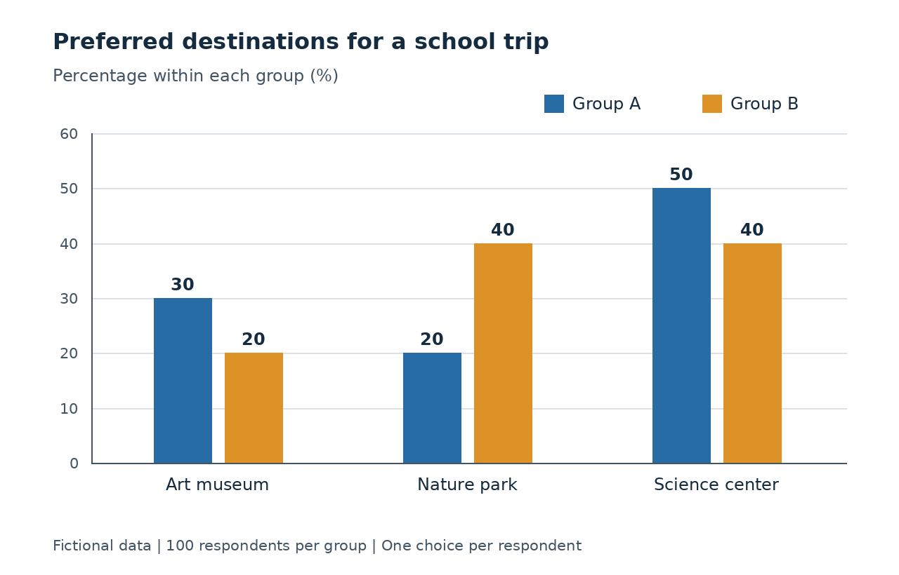

# 영어 가이드 v1.0 검수 기록

검수일: 2026-11-03 (한국 시간)  
대상: [수능_영어_문제출제_가이드라인.md](../수능_영어_문제출제_가이드라인.md), v1.0.0  
검수 주체: 작성 AI의 자체 재검토. 독립 전문가·다른 AI·실제 수험생 검사는 수행하지 않았다.  
용도: 공개 제작 명세의 재현 가능한 검수 자료. **아래 창작 사례에는 정답·해설이 포함된다. 학습자에게 낸 시험이나 개인 성적 기록이 아니다.**

## 1. 실제 조사 범위

출처의 전체 링크와 지위는 본문 16절의 S1~R1에 있다. 같은 문서를 여러 게시처에서 찾은 것을 별도 독립 근거로 세지 않았다.

| 자료군 | 실제 확인 | 적용 범위 |
|---|---|---|
| 평가원·교육부 S1~S3 | 2027 수험 안내의 구성·영어 부분, 시행기본계획 발표, 2026 출제 브리핑 | 목표·범위·형식·배점 고려 요소 |
| P1 | 2026 수능 홀수형 읽기 18~45 텍스트 열람, 아래 8문항의 정답·근거 비교 | 어법·어휘·추론·담화 등 구현 관찰 |
| P2 | 2027 6월 모평 21·33·39·40 중심 열람 및 정답 비교 | 다른 회차의 함축·빈칸·삽입·요약 |
| P3 | 2027 9월 모평 읽기 4문항, 듣기 8문항의 문제·정답·대본 대조. 대본 1~17 열람 | 듣기 대본·표 및 읽기 관계 비교 |
| Cambridge A1 | 문항 제작·편집·예비검사, 타당화 관련 절 | 자체 검수와 응시 자료 검증의 구별 |
| ETS A2 | 공정성·평가 목표와 무관한 장벽·문화적 차이 관련 부분 | 불필요한 배경지식·언어 장벽 점검 |
| 국내 연구 R1 | 서지·초록 | 형식과 실제 인지 요구의 구별을 보조. 결과 재현 아님 |

확인한 자료는 **국내 공식 자료 3종, 시험 묶음 3회, 해외 평가기관 지침 2종, 논문 초록 1종**이다. 시험 묶음에는 각각 문제와 정답이 있으며 P3에는 대본이 추가된다. 이 수치는 기관 9개나 독립 연구 9편을 뜻하지 않는다.

신뢰도 판단:
- S1~S3은 제도·공식 의도를 확인하는 우선 근거다. 출제 의도만으로 실제 난도·변별도를 입증할 수 없다.
- 기출 PDF는 평가원 표기가 있는 제삼자 게시 사본이다. 문항 자체를 읽는 근거로 썼으나 공식 서버 파일과 바이트 동일성을 검증하지 못했다.
- Cambridge·ETS는 실제 평가 개발 기관의 일차 지침이지만 자기 기관의 운영 관점이다. 수능 공식 명세나 본 자작 문항의 실증 검증으로 사용하지 않았다.
- R1은 본문을 읽지 않았다. 초록에 제시된 분류 수치도 합계 해석에 의문이 있어 인용하지 않았다. 분류 관점만 참고했다.
- 공식 학습 방법 안내의 큰 PDF, 교육과정 기본 어휘 목록 전체, EBS 분석 본문, ILTA 지침은 확보·대조하지 못했다. 출처 목록에 제목만 넣어 읽은 자료로 세지 않았다.
- 기출 그림은 이번 환경에서 판독 가능한 이미지가 반환되지 않았다. 그래프 원그림·4번 그림 검증은 제외했다. 표 텍스트를 읽은 검사와 실제 그림 검사를 구별했다.
- 음원은 재생하지 않았다. 듣기 문항에 관한 아래 결과는 **대본과 문제의 의미·계산·화행 검사**다.

### 1.1 다른 과목 가이드 확인

| 파일 | 읽은 버전 | 확인한 Git blob SHA |
|---|---|---|
| 국어 가이드 | 2.0.1 | 720adc82b851f4559b3eb4ed1335f431d696b11d |
| 수학 가이드 | 3.0 | af38024cd99b6a1ec7e62da907b3c13a8e28deaf |
| 직탐 가이드 | 1.0 | 1c697a04aa6080c1a5649c67133070a41064f3fa |

본문을 읽고 근거표·반례·최단 풀이·재검수·원격 검증 구조를 참고했다. 영어 문항에 국어의 논증 구조나 수학의 엄밀한 연역 증명을 일괄 강제하지 않았다.

## 2. 기출 24문항 적용 기록

표의 정답·배점은 각 정답표와 대조했다. 아래는 원문 복제가 아니라 검수 관점의 분석이다. 공식 해설로 표시하지 않는다. 열람한 주변 문항은 정밀 대조 개수에 포함하지 않았다.

| ID | 시험·번호 | 답·점수 | 실제 판정에 사용한 관계 | 가이드에 반영한 검사 |
|---|---|---|---|---|
| P1-21 | 2026 수능 21 | ②·2 | 작업 수행의 장소 제약 완화 | 비유의 문맥 의미와 부분 결과 구별 |
| P1-29 | 2026 수능 29 | ②·2 | 주절의 정동사 자리 | 구조상 오류와 문체 선호 구별 |
| P1-30 | 2026 수능 30 | ⑤·3 | 경쟁 상황과 어휘의 방향 | 정상 교정 후 논지 회복 |
| P1-33 | 2026 수능 33 | ④·2 | 설계 과정의 이용자 참여 | 참여 주체·시점이 다른 후보 배제 |
| P1-35 | 2026 수능 35 | ④·2 | 시간 사용 논의와 선택 비교의 이탈 | 소재가 아닌 문장 기능 검사 |
| P1-36 | 2026 수능 36 | ④·2 | 반복 과정, 겉보기 반례, 추가 설명 | C-A-B 연결과 반례의 위치 |
| P1-38 | 2026 수능 38 | ⑤·2 | 일반 설명에서 정체성 사례로 연결 | 삽입문 오른쪽 연결 의무 |
| P1-40 | 2026 수능 40 | ③·2 | 운영의 어려움과 관객 확보 | 요약 두 칸의 관계·품사 대조 |
| P2-21 | 2027 6월 21 | ②·3 | 인간에게만 의식이 있다는 가정의 포기 | 배타성과 우월성 구별 |
| P2-33 | 2027 6월 33 | ②·3 | 감정이 오인에 필요한 유사성에 미치는 방향 | 비교 방향의 역전 탐지 |
| P2-39 | 2027 6월 39 | ③·3 | 색의 다양성에서 명명 어휘로 연결 | 앞의 확장과 뒤의 어휘 설명 동시 검사 |
| P2-40 | 2027 6월 40 | ⑤·2 | 경제적 이유의 소외와 대상 확대 | 요약문 대상·인과 보존 |
| P3-5 | 2027 9월 5 | ⑤·2 | 화자별 완료·예정 업무 | 같은 행동의 주체·시점 분리 |
| P3-6 | 2027 9월 6 | ②·2 | 항목별 합계에 할인 적용 | 할인 대상과 재계산 |
| P3-8 | 2027 9월 8 | ③·2 | 여러 안내 속성 중 미언급 정보 | U를 C로 설명하지 않음 |
| P3-10 | 2027 9월 10 | ④·2 | 연령·경험·시간·체험 조건의 교집합 | 표 셀과 발화 조건 연결 |
| P3-13 | 2027 9월 13 | ⑤·3 | 사전 규칙 확인 제안에 대한 응답 | 소재 반복과 화행 적합성 분리 |
| P3-15 | 2027 9월 15 | ①·3 | 사진 접근 제한을 권하는 말 | 상황 서술과 실제 발화 구별 |
| P3-16 | 2027 9월 16 | ③·2 | 여러 장소의 노래가 갖는 공통 기능 | 사례 목록과 대의 구별 |
| P3-17 | 2027 9월 17 | ③·2 | 장소의 언급 여부 | 16번과 다른 판정 근거 유지 |
| P3-21 | 2027 9월 21 | ②·3 | 검색 제안이 집단 관심을 반영 | 작동 과정과 비유 대상 구별 |
| P3-34 | 2027 9월 34 | ④·3 | 이해 불가와 너무 쉬움 사이의 조건 | 두 극단을 함께 배제 |
| P3-37 | 2027 9월 37 | ④·3 | 다양성→선발→개체 규모 확대 | C-A-B의 의존 관계 |
| P3-39 | 2027 9월 39 | ③·3 | 단일 요소의 한계에서 균형 설명으로 | 연결어 하나로 위치 확정하지 않음 |

### 2.1 근거 대조의 구체적인 결과

**P1-29:** ②의 비정형 동사만으로는 해당 주절을 완성할 수 없다. 교정형은 정동사이며, 다른 표시들은 각각 부정사·관계 구조·분사·동사 수 일치로 허용된다. 따라서 ‘문법만으로 풀리면 결함’이라는 규칙은 어법형에 적용할 수 없다.

**P1-33:** 설계 의견 수렴은 이용자의 다양한 요구를 반영하는 관계다. 이용자에게 설계 훈련을 시키거나, 설계자를 신뢰하게 하거나, 이용자끼리 의견을 나누게 하는 후보는 필요한 관계를 대체한다. 단순히 공통 명사를 포함한다고 답이 되지 않는다. 2점에서도 관계 판단이 필요하지만 이를 곧 고난도로 부르지는 않는다.

**P2-33:** 기대한 대상으로 잘못 보는 데 필요한 유사성의 정도가 핵심이다. 감정의 존재만 찾는 풀이로는 비교 방향을 판정하지 못한다. 반면 그 핵심 비교를 정확하게 읽으면 글의 모든 세부를 다시 계산할 필요는 없다.

**P3-10:** 11세가 참여 가능하고, 이미 경험한 프로그램을 피하며, 70분은 제외하고, 4D 체험이 가능한 행을 고르면 D가 남는다. 조건들은 표를 줄이는 독립 필터다. 여러 조건이라는 이유만으로 복합 논증이라고 부풀리지 않았다.

**P3-34:** 낯섦이 지나치면 이해가 안 되고, 기대와 너무 같으면 유머가 사라진다는 두 제약을 유지해야 한다. 편안한 상황이라는 부분 조건만으로는 부족하다. 배경 심리 이론을 해설에서 추가하지 않아도 판정할 수 있다.

**P3-6 계산 재현:** 성인 2명×15달러 + 어린이 1명×10달러 + 수업 10달러 = 50달러. 전체에 10% 할인이 적용되어 45달러다. 이 계산은 대본 조건의 확인이며 음원 인식 능력 검증이 아니다.

### 2.2 여기서 내릴 수 있는 결론

- 유형 구분은 유지해야 한다. 도표·빈칸·순서·삽입은 자료 구조와 실패 조건이 다르다.
- ‘형식이 빈칸이다’와 ‘떨어진 근거를 결합해야 한다’는 서로 다른 주장이다. 형식과 실제 능력을 함께 기록해야 한다.
- 2·3점, 문장의 추상성, 단서 개수만으로 실측 난도를 확정할 수 없다.
- S/C/U뿐 아니라 발문 적합성·화행·담화 위치를 따로 판정해야 한다.
- 이 표본으로 모든 기출의 유형 빈도·정답률·변별도·연도별 난도 변화를 추정하지 않았다.

## 3. 창작 사례 7종

모든 영어 본문·선지는 이 검수를 위해 창작했다. 실제 연구·학교·기관의 실험 결과가 아니다. 기출 문장을 바꿔 붙인 변형으로 표시하지 않는다. 각 사례는 작동 검사이며, 전부를 고난도 실전 문항으로 표방하지 않는다. 비교 준거는 위 표의 **판정 구조**이고 문장 수준·정답률의 동일성은 검증하지 않았다.

### V1. 빈칸 — 목적에 맞는 평가 기준

**문항. 다음 빈칸에 들어갈 말로 가장 적절한 것을 고르시오. [2점 제안]**

A museum was comparing two sets of labels for an exhibition. In its first trial, visitors were asked to find a date mentioned in each label. They completed this task faster with the shorter labels, so the staff initially considered adopting them. Yet the exhibition also invited visitors to compare two different accounts of the same event. The shorter labels had removed the sentences explaining why those accounts differed. When visitors were asked to make that comparison, many could repeat the dates but could not explain the disagreement. The staff therefore kept the factual search task and added a task requiring visitors to connect the accounts. The first test had measured something useful, but it had treated one purpose of reading as if it represented every purpose. A useful evaluation should therefore ______.

① treat the fastest factual search as the most reliable sign of understanding  
② allow differences in reading purpose to shape its measures of success  
③ use agreement among visitors as the main test of historical accuracy  
④ judge the quality of labels before observing how visitors use them  
⑤ restrict comparisons to questions that require a single factual answer

**정답 ②.**
- 구조: 첫 실험과 잠정 결론 → 다른 독서 목적 → 생략된 연결 설명 → 실패 관찰 → 평가 과제 보완 → 일반화.
- 주능력: 평가 목적과 성공 기준의 관계 재진술. 특수한 박물관 지식은 필요 없다.
- 정상 복원본: 빈칸에 ②를 넣으면 두 종류의 읽기 목적을 반영하는 결론이 된다.
- ① C: 빠른 사실 검색이 다른 이해 목적까지 대표하지 못한 것이 문제다.
- ② S·적합: 서로 다른 읽기 목적에 대응하는 기준을 마련한다.
- ③ U·부적합: 방문객의 의견 일치로 역사적 정확성을 정하는 절차는 제시되지 않았다.
- ④ C·부적합: 사용 결과를 관찰하며 평가 기준을 보완한다는 방향과 다르다.
- ⑤ C: 단일 사실 찾기에 한정했던 평가를 확장한 전개를 되돌린다.
- 가장 강한 대안 ①: 첫 실험에서 속도가 유용한 지표였다는 사실은 맞다. 그러나 이를 ‘가장 신뢰할 이해 지표’로 확장하는 부분은 후속 비교 과제의 실패로 배제된다.
- 최단 타당 풀이: 끝에서 두 번째 문장의 목적 혼동을 읽고 ②를 고를 수 있다. 글 전체의 모든 세부를 통합해야만 풀리는 고난도 문항이 아니다. 관계 재진술 연습으로 판정했다.
- 언어 검사: 모든 선지는 should 뒤 동사원형으로 결합한다. 정답의 문법적 형태만으로 소거되지 않는다. accounts는 사건에 대한 설명이라는 문맥 뜻이며 회계 의미를 요구하지 않는다.
- 재판정: 논리·영어 자체 검수 통과. 난도는 제안이며 응시 자료 없음.

### V2. 문장 삽입 — 잠정 결과와 교란 가능성

**문항. 글의 흐름으로 보아 주어진 문장이 들어가기에 가장 적절한 곳을 고르시오. [2점 제안]**

> However, the trays watered on a fixed schedule had stood in a sunnier part of the garden, so the groups could not yet attribute the difference to their watering rules.

At a community garden, two groups watered identical trays of seedlings. ( ① ) One followed a fixed schedule; the other checked the soil before deciding whether to add water. ( ② ) After two weeks, the second group had used less water, and its seedlings looked equally healthy. ( ③ ) To remove this possible explanation, both groups repeated the trial for another two weeks, with the tray locations exchanged. ( ④ ) The difference in water use appeared again, making the watering rule a more plausible explanation than location alone. ( ⑤ ) They therefore decided to continue testing that rule on a larger set of trays.

* seedling: 묘목 / attribute A to B: A를 B의 결과로 보다

**정답 ③.**
- 앞의 결과를 잠정적으로 제한하고, 뒤의 위치 교환 실험에 이유를 제공하는 문장이다.
- 주어진 문장의 the difference는 물 사용량 차이를 받는다. 뒤의 this possible explanation은 햇빛 위치 차이를 받는다.
- 햇빛이 물 사용에 미치는 구체적 과학 법칙까지 알아야 하는 문제로 만들지 않았다. 지문 자체가 위치를 다른 가능한 설명으로 제시한다.

| 위치 | 왼쪽 연결 | 오른쪽 연결·전체 | 판정 |
|---|---|---|---|
| ① | 아직 두 규칙·관찰된 차이가 소개되지 않음 | 이후 규칙 설명과 대비 대상이 맞지 않음 | 배제 |
| ② | 규칙은 있으나 결과 차이가 아직 없음 | 뒤에 결과를 먼저 제시한 뒤 다시 ‘이 설명’으로 가면 대조의 기능·정보 순서가 뒤틀림 | 배제 |
| ③ | 관찰된 차이에 대한 유보 성립 | 위치 설명을 제거하려는 재실험의 이유 제공 | 채택 |
| ④ | 재실험 후에 이전 유보를 회상하는 읽기는 가능해 보임 | 그러나 재실험 문장 속 this possible explanation이 먼저 근거 없이 등장함 | 배제 |
| ⑤ | 재실험에서 다시 확인한 결과와 유보 시점이 충돌 | 위치를 통제한 뒤에도 초기 위치 차이를 미해결 근거로 되돌림 | 배제 |

- 초안에서는 재실험 문장이 “Both groups then repeated the trial…”이었다. ④에 놓고 초기 우려를 뒤늦게 설명하는 해석을 충분히 배제하기 어려웠다.
- 수정: 재실험을 “To remove this possible explanation…”으로 연결했다. 새 과학 조건을 덧붙인 것이 아니라 문제→대응 관계를 본문에 명시했다.
- 재검수: 다섯 위치 모두 비교했다. ③에서만 결과→대안 설명→그 설명을 통제하는 조치가 순서대로 연결된다.
- 최단 풀이: this possible explanation의 선행 내용과 삽입문의 원인을 맞추면 빠르게 해결된다. 정상적인 담화 연결 풀이이며 고난도라고 표시하지 않았다.
- 영어: 과거완료 had stood는 최초 실험의 배치를 회상한다. 동일한 묘목이라고 단정하지 않고 동일 형태의 trays라고 썼다. 최종 재실험 결과도 인과 증명을 확정하지 않고 more plausible로 제한했다.

### V3. 글의 순서 — 새 규칙과 그 적용

**문항. 주어진 글 다음에 이어질 글의 순서로 가장 적절한 것을 고르시오. [2점 제안]**

A town archive invited residents to help identify people in old photographs. Staff first placed numbered copies on a table and asked visitors to write names on separate slips.

(A) These explanations gave the staff something they could compare with other records. A proposed name supported by a matching address was treated differently from one based only on a familiar face. The display was then updated to distinguish confirmed identifications from suggestions still being checked.

(B) The first pile of slips contained several conflicting names for the same face. Two visitors, for example, each said that the woman in photograph 17 was their own grandmother. The staff therefore decided that every proposed name needed an explanation.

(C) Under this new rule, visitors began to add details about where a relative had lived or when a family event had occurred. Others explained that they were simply recognizing a face and had no additional information.

① (A)－(C)－(B)  
② (B)－(A)－(C)  
③ (B)－(C)－(A)  
④ (C)－(A)－(B)  
⑤ (C)－(B)－(A)

**정답 ③, B-C-A.**

| 배열 | 실제 연결 판정 |
|---|---|
| A-B-C | A의 These explanations가 이름만 적은 최초 쪽지에서 확보되지 않음. C의 새 규칙 적용보다 설명 활용이 먼저 옴 |
| A-C-B | 위 문제에 더해 C의 new rule이 아직 없음 |
| B-A-C | 규칙을 세운 뒤 실제 설명이 제출되는 C보다 A의 설명 활용이 먼저 옴 |
| B-C-A | 이름 충돌→설명 요구 규칙→설명 제출→대조·등급화. 모든 의존 충족 |
| C-A-B | new rule의 근거가 B 뒤에 나옴 |
| C-B-A | 같은 선행 규칙 부재에 더해 이미 규칙을 적용한 뒤 규칙을 새로 세움 |

- 최소 의존: B가 C보다 앞, C가 A보다 앞. 이 두 제약이면 여섯 배열 중 하나가 남는다.
- ‘설명을 요구했으니 설명은 제출된 것으로 상상 가능’이라는 B-A-C 해석은 검토했다. A의 지시·활용에 필요한 실제 제출 설명을 생략한 뒤 C에서 새로 소개하므로, 이를 제공한 B-C-A보다 부자연스럽고 정보 의존이 거꾸로다.
- 최단 타당 풀이: new rule과 These explanations의 지시 연결을 확인한다. 사건 전체의 전문지식이나 기록 보존 정책은 필요 없다.
- 난도: 명시적 지시 관계 중심의 기본 담화 훈련. 문단 수만으로 복합 추론이라고 부르지 않았다.
- 영어: identifications는 사람의 신원 판정, suggestions는 미확정 제안으로 일관된다. 두 방문객의 주장으로 실제 인물을 확정하지 않았다.

### V4. 어법 — 주절의 정동사

**문항. 다음 글의 밑줄 친 부분 중, 어법상 틀린 것은? [2점 제안]**  
이 Markdown 검수본에서는 밑줄 위치를 굵게 표시한다. 실제 문제 출력 때에는 밑줄로 바꾸고 표시 범위를 재검사한다.

When a school invited students to redesign its reading room, teachers expected suggestions about chairs and shelves. One group ① **suggested** dividing the room into two areas. Students ② **who** preferred quiet reading asked for desks away from the entrance. Those ③ **working** together wanted tables near the materials they shared. Rather than ④ **choosing** one arrangement immediately, the committee decided to test both for a week. The main purpose of these temporary arrangements ⑤ **being** to discover how different groups used the space. After the trial, students could comment on arrangements they had actually experienced.

**정답 ⑤, being → was.**

| 표시 | 구조 | 판정 |
|---|---|---|
| ① suggested | One group의 과거 정동사, 뒤에 동명사 목적어 | 정상 |
| ② who | Students를 받는 관계절의 주어 | 정상 |
| ③ working | Those를 수식하는 분사, 함께 작업하는 사람들 | 정상 |
| ④ choosing | Rather than 뒤의 동명사구. 주절의 committee와 행위 주체 일치 | 정상 |
| ⑤ being | 마침표로 독립된 문장의 주어 The main purpose 뒤에 정동사가 없음 | 오류 |

- those working together는 those who were working together와 대응한다. 문체 선호 때문에 오류로 보지 않는다.
- ⑤를 분사구문으로 구제하려면 앞의 마침표를 바꾸는 등 문제에 없는 수정을 해야 한다. 제시 문장에서는 독립 주절이다.
- 정상 복원본은 was를 넣은 글. 다른 네 표시와 표시 밖의 문장도 다시 읽었다.
- 최단 풀이가 통사 분석인 것은 목표에 맞는다. ‘전체 논지 이해 없이 답이 나온다’는 이유로 거부하지 않았다.
- 이 사례는 최종 시험지의 실제 밑줄·인쇄 검증까지 마친 문항이 아니라 Markdown 제작 검사다.

### V5. 요약 — 공통 기준과 다양한 수단

**문항. 다음 글의 내용을 한 문장으로 요약하고자 한다. (A), (B)에 들어갈 말로 가장 적절한 것은? [2점 제안]**

An after-school science club required each member to explain one finding before it was added to the club's report. At first, everyone had to speak for one minute in front of the group. Some members had prepared clear notes but struggled with this format, while others spoke confidently without being able to answer questions about their findings. The organizer kept the requirement to explain a finding but allowed either a short recording or a live explanation. Every member still had to answer follow-up questions. The club wanted evidence that members understood their work; making them use the same form of presentation was only one possible way of seeking it.

The club preserved a common (A) ______ while allowing variation in the (B) ______ used to demonstrate understanding.

| 번호 | (A) | (B) |
|---|---|---|
| ① | standard | purpose |
| ② | procedure | method |
| ③ | standard | method |
| ④ | procedure | result |
| ⑤ | preference | purpose |

**정답 ③.**
- A의 근거: 자신의 발견을 이해하고 설명한다는 요구와 후속 질문은 유지했다.
- B의 근거: 녹음·실시간 설명이라는 발표 수단은 달라졌다.
- ① A는 맞으나 B가 목적을 바꾼다고 해서 틀림. ② B는 맞으나 동일 절차를 보존한 것이 아니어서 틀림.
- ④ 절차와 결과 모두 중심 구별을 보존하지 않음. ⑤ 개인 선호를 공통 기준으로 바꾸고 목적도 혼동함.
- A만 알면 ①·③, B만 알면 ②·③이 남는다. 두 칸의 의미를 결합하면 ③이다. 품사는 모두 명사로 문법적 우회가 없다.
- 과거의 동일 절차가 존재했다는 사실(S)과 요약문에서 그 절차가 유지되었다는 주장(C)을 구분했다.
- 국소 풀이: 마지막 두 문장과 앞의 대안 형식만으로 충분하다. 기초 요약 관계 훈련이며 두 칸이라는 이유로 고난도라고 하지 않았다.
- 어법·연어: a common standard, variation in the method, demonstrate understanding을 문맥과 대조했다. 허용한 두 형식을 ‘개인에게 전적으로 자유로운 평가’로 확대하지 않았다.

### V6. 응답 선택 — 대본만 검수한 경우

**문항. 대화의 마지막에 남자가 할 말로 가장 적절한 것을 고르시오. [2점 제안]**  
상태: 음원 없는 대화 독해용. 실제 듣기 문항으로 배포하거나 듣기 점수를 산출하지 않는다.

M: Have we sent out the invitations for Friday's workshop?  
W: Not yet. I noticed that the poster says four o'clock, but we agreed yesterday to start at five.  
M: You're right. I corrected the poster on my computer, but I haven't printed it.  
W: The file in our shared folder still has the old time. I was about to download it for the invitations.  
M: Then I must have forgotten to upload the new version.  
W: Could you replace the file before I download it?  
M: ______

① Yes. We decided yesterday to keep the original starting time.  
② Certainly. I'll ask the guests to design a different poster.  
③ Right. I downloaded the old version before you changed it.  
④ Sure. I'll upload the corrected version now.  
⑤ Thanks. The printed invitations have already reached everyone.

**정답 ④.**
- 상태표: 여자 초대장 미발송 / 남자 로컬 파일 수정 완료 / 남자 출력 미완료 / 공유 폴더 교체 미완료 / 여자 다운로드 예정.
- ① 합의한 시간 변경과 충돌. ② 파일 교체 요청을 다른 사람의 디자인 작업으로 바꿈. ③ 파일을 수정한 주체를 뒤집고 미해결 요청을 수행하지 않음. ④ 요청된 교체를 약속함. ⑤ 미발송·미출력과 충돌.
- 가장 강한 대안 ②: 실제로 부탁을 할 수는 있지만 현재 요청 해결에는 불필요하며 디자인 변경 요구도 없다. 현실에서 가능한 말이라는 것과 가장 적절한 후속 발화는 다르다.
- 최단 풀이: 직전 요청만으로 ④가 상당히 뚜렷하다. 화행 진단에는 유효하지만 긴 대본 전체 통합 문제로는 약하므로 그 용도로 표방하지 않았다.
- 모든 후보는 실제 발화 가능한 문장이다. 소리·속도·강세·화자 식별은 전혀 검증하지 않았다.

### V7. 도표 — 비율과 배수의 영어 표현

**문항. 다음 도표의 내용과 일치하지 않는 것은? [2점 제안]**

가상의 두 집단이 현장 학습 장소를 하나씩 선택한 결과다. 각 집단의 응답자는 100명이며 무응답·중복 응답은 없다. 단위는 각 집단 내 백분율이다.

검수용 원자료:

| Destination | Group A (%) | Group B (%) |
|---|---:|---:|
| Art museum | 30 | 20 |
| Nature park | 20 | 40 |
| Science center | 50 | 40 |

① The science center was the most popular destination in Group A.  
② In Group B, the nature park and the science center received equal percentages.  
③ The percentage choosing the art museum was ten percentage points higher in Group A than in Group B.  
④ The percentage choosing the nature park in Group B was less than twice that in Group A.  
⑤ In each group, a higher percentage chose the science center than the art museum.

**정답 ④.**

| 선지 | 실제 대조 | 판정 |
|---|---|---|
| ① | A의 50 > 30, 20 | S·일치 |
| ② | B의 40 = 40 | S·일치 |
| ③ | 30 − 20 = 10 percentage points | S·일치 |
| ④ | 40은 2×20과 같음. 40 < 40은 거짓 | C·불일치 정답 |
| ⑤ | A: 50 > 30, B: 40 > 20 | S·일치 |

- 분모가 각 집단 내부라는 점을 제목·축·범례와 함께 확인한다. 각 집단의 합은 100%.
- ④는 ‘두 배보다 작다’와 ‘정확히 두 배다’의 구별이다. percentage point와 percent 증가율을 혼동하지 않는다.
- 특별한 산술 추론은 없다. 영어 비교 관계를 수치에 대응하는 기본 도표 문항이다.
- 그래프는 원자료로 프로그램 생성하고 저장된 이미지로 시각 검사한다. 기출 그래프 미판독 상태를 이 자작 그림의 검사로 대체하지 않는다.
- 실제 이미지 및 계산 실행 결과는 5절에 기록한다.

## 4. 결함 주입과 정상 보존 검사

이 검사는 통계적 탐지 성능 평가가 아니다. 구체적으로 바꾼 후보를 다시 읽어 가이드가 어떤 결함을 지적하는지 확인한 수작업 검사다. 7개 기본 사례에서 검사한 변형 10개를 기록했다. 수정 후 기준 사례로 복구하고 동일 검사를 반복했다.

| ID | 실제 주입한 변경 | 발견한 문제·처리 | 관련 규칙 |
|---|---|---|---|
| D1 | V1의 ③을 “adapt its success criteria to the different goals that readers have”로 대체 | ②와 동의인 정답이 추가됨. 치명, 후보 교체 | 5.2 중복 후보 |
| D2 | V1에서 다른 독서 목적·생략된 연결 설명·비교 실패·추가 과제에 해당하는 중간 네 문장을 삭제 | 끝의 결론을 선언할 수는 있어도 앞의 실제 관찰이 이를 뒷받침하지 못함. 목표한 사례→평가 기준 관계 검사 실패. 문장 복구 | 4.1 전개·G1 |
| D3 | V1의 네 오답만 동사를 과거형으로 바꿈(treated/used/judged/restricted) | should 뒤 문법만으로 ②가 남음. 정답 유일해도 의미 빈칸 목표 불일치 | 6.2·7.8 |
| D4 | V2의 재실험 문장을 초안 “Both groups then repeated the trial for another two weeks, with the tray locations exchanged.”로 되돌림 | ④의 회상 설명을 충분히 배제하기 어려움. 위치 유일성 보류, 좌우 의존이 있는 최종 문장 사용 | 7.11 |
| D5 | V4의 ① suggested를 suggest로 바꿈 | 단수 One group과 현재형 suggest가 맞지 않아 ①·⑤ 두 오류. 치명, ① 복구 | 7.6 전체 검사 |
| D6 | V5의 ①·②를 각각 preference/purpose, procedure/result로 교체 | standard만 파악해도 ③ 단독. 복수 답은 아니지만 두 칸 결합 목표 미달. 원래 교차 선지 복구 | 7.12·10.3 |
| D7 | V6 정답을 “Sure. You can upload the corrected version now.”로 바꿈 | 수정본을 가진 남자의 교체 요청 수락이 여자의 업로드 허락으로 바뀜. 정답의 주체·화행 실패 | 8.1 |
| D8 | V7 ④의 less than twice를 exactly twice로 바꿈 | 다섯 선지가 모두 일치. 불일치형의 정답 없음. 원형 복구 | 7.5·G2 |
| D9 | V7 원자료의 Group B nature park를 30으로 바꾸고 그림·선지 유지 | 합계·그림·원자료 불일치, ②도 달라짐. 자료 버전 충돌. 데이터·그림 함께 재생성 필요 | 7.5·G7·G8 |
| D10 | V6에 “듣기 완성·검증 완료” 판정만 추가 | 실제 음원 없이 매체 완성 주장. 대본 검수 상태로 되돌림 | 8.2·11.1 |

D2는 정답이 반드시 사라진다는 주장이 아니다. 마지막 두 문장만으로 ②가 여전히 드러날 수 있다. **정답 유일성과 글의 전개 완성도·목표 적합성이 별개**임을 확인하는 변형이다.

정상 사례를 거부하지 않는지도 검사했다.

| 정상 사례 | 위험한 과잉 규칙 | 올바른 판정 |
|---|---|---|
| P1-29·V4의 문법 풀이 | 전 지문 의미 통합 없이 풀면 불량 | 어법 목표에 맞는 타당한 짧은 풀이 |
| V1의 마지막 명제 활용 | 정답의 재진술이 명시되면 금지 | 관계 재진술 연습으로 허용, 난도 과장 금지 |
| V3의 지시 관계 풀이 | 연결 단서가 뚜렷하면 폐기 | 담화 능력을 사용하므로 정상, 기본용 분류 |
| V5의 과거 동일 절차 | 오답 속 단어가 실제 본문에 있으면 맞음 | 사실의 시점·유지 여부를 포함한 주장 전체 판정 |
| V7의 단순 계산 | 모든 2점에도 복합 추론 강제 | 자료·영어 비교 이해 목표로 허용 |
| V6 대본의 활용 | 음원이 없으면 어떤 연습도 금지 | 대화 독해로 사용 가능, 듣기 성적·완성 음원 주장 금지 |

## 5. 실제 실행·표시 검사

### 5.1 기계 검사의 범위

아래 계산을 Python으로 실행했다. 언어 의미에서 도출한 제약을 코드에 넣은 것이므로, 코드가 그 제약의 언어학적 정당성까지 증명하지는 않는다.

~~~python
from itertools import permutations
from decimal import Decimal

orders = list(permutations("ABC"))
valid = ["".join(p) for p in orders
         if p.index("B") < p.index("C") < p.index("A")]
assert valid == ["BCA"]

A, B = [30, 20, 50], [20, 40, 40]
claims = [
    A[2] > max(A[:2]),
    B[1] == B[2],
    A[0] - B[0] == 10,
    B[1] < 2 * A[1],
    A[2] > A[0] and B[2] > B[0],
]
assert claims == [True, True, True, False, True]
assert sum(A) == sum(B) == 100

total = (Decimal(2)*15 + 10 + 10) * Decimal("0.90")
assert total == Decimal("45.00")

pairs = [
    ("standard", "purpose"), ("procedure", "method"),
    ("standard", "method"), ("procedure", "result"),
    ("preference", "purpose"),
]
a_only = [i+1 for i,p in enumerate(pairs) if p[0] == "standard"]
b_only = [i+1 for i,p in enumerate(pairs) if p[1] == "method"]
assert a_only == [1, 3] and b_only == [2, 3]
assert set(a_only) & set(b_only) == {3}
~~~

실제 실행 결과(2026-11-03):

~~~json
{
  "order_candidates": 6,
  "valid_orders": ["BCA"],
  "chart_claims": [true, true, true, false, true],
  "group_totals": [100, 100],
  "P3_6_total": "45.00",
  "summary_A_candidates": [1, 3],
  "summary_B_candidates": [2, 3],
  "actual_items": 24,
  "authored_cases": 7,
  "defect_cases": 10,
  "chart_size": [1280, 820]
}
~~~

계산 단언문은 모두 통과했다. 문서에서 ID를 추출하여 기출 24개·제작 7개·결함 변형 10개의 중복 여부도 검사했다. 이 개수 검사가 각 내용의 타당성을 자동 입증하는 것은 아니다.

도표 PNG를 실제 이미지로 열어 제목, 집단 범례, 백분율 단위, 0~60 축, 6개 막대와 값(30·20 / 20·40 / 50·40), 항목명, 가상 자료·표본 안내가 잘림 없이 표시되는지 확인했다. 높이·수치·범례가 원자료와 일치했다. 검사한 이미지의 SHA-256은 `5f2476e5be9ab64f39d1bde6748142d4e8aebd79afb13f0773674a72b2cded13`이다. GitHub 모바일의 모든 화면 크기에서 재렌더링한 검사는 아니다.

### 5.2 가이드 본문의 정합성 점검

본문을 실행 계약→설계→문항화→근거 판정→유형 검사→언어·매체 검사→배포→개정 순으로 다시 읽었다.

| 점검 대상 | 확인 결과 |
|---|---|
| 모호한 목표 문구 | '자연스러움'을 문장 기능·지시·전환·구조·용례 검사로, '매력적인 오답'을 의미 변형·배제 근거표로 구체화 |
| 상충하는 요구 | 정상 복원본과 의도된 오류, 사실 상태와 발문 적합성, 정당한 단축 풀이와 외형 단서, 자체 검수와 실측 검증을 분리 |
| 중복의 위치 | 공통 원칙은 4~6·9~11절, 유형 고유한 조작과 증거는 7~8절에 배치. 동일 금지 사항을 사례마다 새 규칙으로 증식시키지 않음 |
| 유형 누락 | 목적·심경·대의·함축·자료·어법·어휘·빈칸·무관 문장·순서·삽입·요약·공통 지문·듣기 하위 형식의 명세 확인. 창작 검증은 7종으로 제한 |
| 정답·해설 | V1~V7 최종 답은 ②·③·③·⑤·③·④·④. 선지별 배제 이유와 정답 복원 내용 대조 |
| 난도 표방 | V1·V3·V5·V6의 짧은 풀이를 명시하고 기본 관계·화행 훈련으로 분류. 실측 수치 없음 |
| 공개 정보 | 개인 실력·교재·진도·답안 미기록. 예문·데이터의 창작 여부 명시 |
| 관리·연결 | 가이드↔검수 기록의 상대 링크와 도표 파일명 확인. 최초 공개 v1.0.0의 이력·기준 출처 연결 |

판정: **텍스트 제작·검수 명세로 공개 가능.** 7종의 자체 검수 범위에서 치명·중대 미해결 결함은 발견되지 않았다. V6는 대화 독해/대본용으로 용도를 제한했고, V4는 최종 시험지 밑줄 검증 전 상태를 명시했다. 전 유형·전 매체가 실전 시험지로 검증되었다는 판정은 내리지 않았다.

## 6. 수정의 의미와 미검증 범위

초판 작성 중 다음 구별을 문서 구조에 반영했다. 사례별 예외를 뒤에 나열하는 방식으로 처리하지 않았다.

| 발견한 설계 문제 | 개선한 구조 | 다시 확인한 사례 |
|---|---|---|
| 유형 구분을 없애면 고유한 완료 조건도 사라짐 | 2.3의 독립 유형, 7.5/7.8/7.10/7.11의 별도 검사 | V1·V2·V3·V7 |
| 오답은 모두 사실로서 거짓이라는 판정은 부족함 | 5절에서 사실 상태와 발문 적합성을 분리 | V5·V6, P3-8 |
| 완전한 본문 요구가 의도된 오류까지 금지할 수 있음 | 4.3에서 정상 복원본과 출제 형태를 분리 | V4, P1-29 |
| 짧은 풀이를 부당한 우회로 다루면 정상 문항도 거부함 | 10.3에서 목표 능력 사용과 외형 단서 누출을 분리 | V1·V3·V4, D3 |
| 텍스트만으로 매체 검증까지 완료할 수 없음 | 8.2·11절에서 음원·시각 자료를 별도 통과 조건으로 설정 | V6·V7, D10 |
| 난해한 장문만으로 문항 난도를 인증하기 쉬움 | 10절에서 부담을 분해하고 실측과 구분 | 모든 사례의 최단 풀이·용도 판정 |

미검증:

- 실제 응시자의 정답률·변별도·소요 시간·선지 반응.
- 독립 영어 전문가의 교열, 전 유형의 창작 실험, 실제 음원 생성·재생.
- 2027 본수능, 모든 연도의 전수 분석, 전체 교육과정 어휘 목록과 기계 대조.
- 기출 원문 시각 배치·음원, 공식 원본 서버와의 해시 일치, 이의심사 최종 확정 공고.

이 기록은 검사한 범위에서 제작 기준이 구체적으로 작동한 결과다. 평가원과 동등한 품질 인증이나 모든 결함을 발견했다는 증거가 아니다.

## 7. 변경 기록

| 버전 | 날짜 | 내용 |
|---|---|---|
| 1.0.0 | 2026-11-03 | 기출 24문항, 창작 7종, 결함 변형 10개, 정상 보존 6종, 계산·표시 검사를 기록. 개인 학습 정보는 포함하지 않음. |

